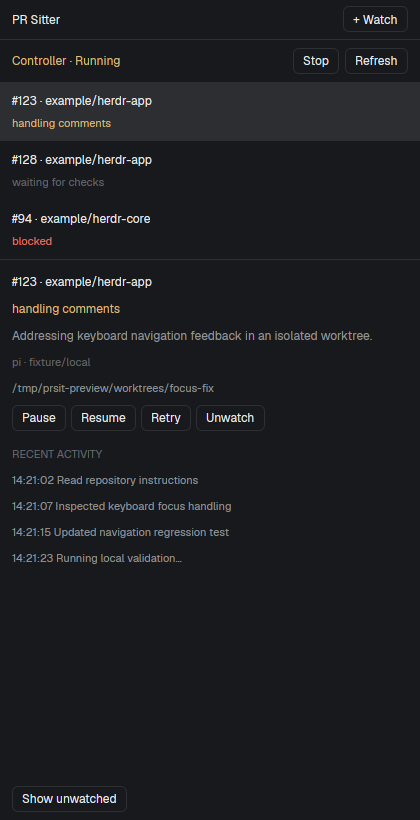

# herdr-prsit

A native **herdr-app mod** and local GitHub PR babysitter, backed by **Pi Durable**.
It polls GitHub deterministically, repairs actionable feedback in isolated
worktrees, publishes guarded fixes, and merges only when its merge gate passes.

The native UI fits alongside [Ship-it](https://github.com/ashrodan/ship-it):
a compact PR Sitter control beside its strip, and a watch/detail panel in the
same side-panel stack. Ship-it keeps its diff, review, and manual shipping UI;
PR Sitter adds autonomous monitoring and repairs without changing Ship-it's code.
Ship-it is optional. The CLI and Ink terminal dashboard remain available.



## Install

Requires Linux or macOS, Node **22.19+**, Git, authenticated `gh`, Pi model
credentials, and current **herdr-app + herdr-core (`hc`)**. The old
`herdr` / herdr-tui plugin API is no longer used. Linux verification is local;
macOS remains unverified until tested on a Mac.

```sh
git clone https://github.com/damianpoole/herdr-prsit.git
cd herdr-prsit
npm ci --ignore-scripts
npm run build
npm link
prsit doctor
prsit models
```

The installer pins the mod to this checkout's built backend and Node executable;
keep the checkout in place. It runs programs on your behalf, reads local watch
state, and ultimately authorizes GitHub writes when you register a PR. Inspect
the code before installing. It does not install credentials or start a controller.

### Alongside Ship-it

Find your personal layout name with `herdr-app status`, then:

```sh
node scripts/install.mjs --layout my-main
herdr-app do layout.switch --name my-main
```

The installer places PR Sitter beside the existing Ship-it strip and adds
`prsit-panel` to `panel-body`. It preserves existing panels, their selection,
and other layout content. Repeating installation does not add duplicate blocks.
It does **not** patch Ship-it, watch its private shared cache, or automatically
register PRs created through it.

Shipped layouts are not edited. To create a personal copy first:

```sh
node scripts/install.mjs --layout my-prs --from main
herdr-app do layout.switch --name my-prs
```

Without Ship-it, the installer adds a PR Sitter strip below the tabs. Without a
side-panel stack, clicking the strip opens a native PR Sitter tab. Layouts with
neither a tabs block nor Ship-it need the blocks added manually.

### Install just the mod / custom locations

```sh
node scripts/install.mjs
node scripts/install.mjs --home /path/to/herdr-app-home --state-home /path/to/prsit-state
```

App home defaults to `$HERDR_APP_HOME`, then `~/.config/herdr-app`.
State defaults to the backend's usual location; `--state-home` or the installer's
`PRSIT_HOME` pins a custom location. Use the same location for CLI controls.
The installer refuses to overwrite an existing mod directory it does not own.

For manual layouts, put this block beside your toolbar:

```json
{
  "id": "prsit-strip",
  "type": "block",
  "size": { "px": 40 },
  "content": { "mod": "prsit", "props": { "role": "strip" } }
}
```

And, if your layout has a `panel-body` stack inside `panel`, add:

```json
{
  "id": "prsit-panel",
  "type": "block",
  "content": { "mod": "prsit", "props": { "role": "panel" } }
}
```

### Update, remove, or migrate

**Update:** `git pull && npm ci --ignore-scripts && npm run build`, then rerun the
installer with the same location/options. The mod hot-reloads; a running
controller keeps its loaded code until you stop and restart it. Backend/mod API
versions must agree.

**Remove:** stop the controller with `prsit stop` if you want work to stop.
Remove the PR Sitter blocks from your personal layout and delete
`mods/prsit/`. The strip's `prsit-toolbar` wrapper can be replaced by its
Ship-it child with the wrapper's original height. Before an in-place layout edit,
installation saves `<layout>.json.before-prsit`; restore that backup only if
you have made no later layout edits you want to retain. A newly created personal
layout can simply be removed after switching away. Watch history/worktrees are
not removed. Uninstalling the UI alone does not stop repairs.

**From herdr-tui:** stop the old controller, remove/unlink its old plugin in that
application, build this version and install the native mod. Existing watch
registrations, durable checkpoints, credentials, and worktrees are reused.
Old `herdr-views/` receipts are ignored and left untouched. No per-watch
terminal panes or synthetic Agents-sidebar entries are created anymore.

## Daily workflow

Click **Start** in PR Sitter, or run:

```sh
prsit start
prsit watch 123 --repo ~/git/my-project --test 'npm test'
prsit status
prsit dashboard
```

`prsit start` starts/reconnects to one persistent, unparented `hc` terminal for
the state directory. `prsit run` runs the same controller in the current
terminal; `--headless` is retained for compatibility. Closing/reloading the mod
or closing the app window does not stop the independent controller. Closing or
killing its actual terminal does. After reboot, restart the controller; hc
recovery does not automatically rerun it. `prsit stop` requests graceful
checkpointed shutdown.

The native panel shows controller health, precise PR stages, selected activity,
repair worktree paths, and **Pause / Resume / Retry / Unwatch**. **+ Watch** takes
a PR number or URL, a local checkout path, and optional model, validation command
and polling interval. CLI registration supports the additional options below.
Errors are displayed; only the backend decides whether a control is actionable.
There is no native merge button or second repair engine.

**Registration authorizes autonomous commits, pushes, review replies,
addressed-thread resolution, and eligible merges.** Work begins only with a
running controller. An agent finishing is never sufficient publication authority.

`prsit open <watch>` opens a native detail tab in the running app.
The terminal dashboard remains usable outside Herdr: ↑/↓ or j/k select, p pauses,
r resumes, t retries, u unwatches, h toggles unwatched history, o opens a native
detail tab, Page Up/Down scroll activity, End follows live output, q closes only
the dashboard. Native activity is bounded; use `prsit logs <watch>` for full logs.

Each machine maintains independent state. This mod targets the **local**
controller and local checkouts, even when another app space is remote. Remote
controller orchestration is not included.

## Models and skills

The default agent uses Pi's existing authentication and model configuration.
Use `--model provider/model-id`, `PRSIT_MODEL`, or Pi's configured default.
Pi Durable and Pi's model library are pinned to **1.4.0**. This is not a Pi
coding-agent CLI subprocess: it does not load CLI extensions, MCP servers, themes,
or prompt templates. Repairs use durable read/write/edit/bash tools and read
repository `AGENTS.md`.

Skills are discovered in order from the repair worktree, registered checkout,
and global directories: `.pi/skills`, `.agents/skills`, `.codex/skills`,
`.claude/skills`, followed by Pi's global skills, `~/.agents/skills`,
`$CODEX_HOME/skills` (default `~/.codex/skills`), and `~/.claude/skills`.
Pi global paths honor `PI_CODING_AGENT_DIR`. Discovery follows symlinks,
deduplicates targets, includes hidden/nested directories, and recognizes only
`SKILL.md` entrypoints. First name wins; missing descriptions and
`disable-model-invocation: true` entries are omitted. Diagnostics appear in logs.
The skill catalog is checkpointed with a conversation; contents stay live on
disk. Skills never grant publication authority. OpenCode keeps its own loading.

OpenCode 2.x is optional:

```sh
prsit watch https://github.com/owner/repo/pull/456 \
  --repo ~/git/repo --agent opencode --model provider/model-id
```

Interrupted OpenCode work is **not** automatically resumed: inspect the session
and worktree, then use `prsit retry`. Explicit permission denials remain in force.

PR numbers resolve from the supplied checkout (or current directory); ambient
`GH_REPO` does not override lookup. URLs can reuse remembered repository mappings.
Ambiguous watched PR numbers require the displayed watch ID or full URL.

## Commands

| Command                 | Behaviour                                                                         |
| ----------------------- | --------------------------------------------------------------------------------- |
| `start`                 | Start/reconnect to an independent persistent hc controller                        |
| `snapshot [watch]`      | Versioned JSON with health, watch stages, and bounded selected activity           |
| `run`                   | Run continuously; Ctrl+C checkpoints pending work                                 |
| `stop`                  | Request graceful controller shutdown and checkpoint pending work                  |
| `run --headless`        | Run without Herdr layout, useful for a service or test host                       |
| `watch <number or url>` | Register a PR and its repository/harness configuration                            |
| `status [--json]`       | Controller liveness and each watch's last published status                        |
| `logs <watch> [-f]`     | Activity and native agent text/tool events                                        |
| `open <watch>`          | Open a native PR detail tab in herdr-app                                          |
| `dashboard`             | Interactive PR stages, details, recent activity, and local controls               |
| `pause <watch>`         | Close the durable runtime, preserving unfinished work                             |
| `resume <watch>`        | Reopen and resume the same checkpointed work                                      |
| `retry <watch>`         | Resume blocked publication; otherwise start a fresh repair and reset retry counts |
| `unwatch <watch>`       | Stop watching and retain history/worktrees; `resume` reactivates it               |
| `doctor` / `models`     | Check environment and available Pi models                                         |

Watch options: `--interval 15m`, `--timeout 30m`, `--max-attempts 3`, `--merge squash|merge|rebase`, `--test '<shell command>'`, `--allow-no-checks`.

For personal projects, `--require-codex-review` adds an optional Codex reaction gate:

```sh
prsit watch 123 --require-codex-review --allow-no-checks --interval 30s
```

Omit `--allow-no-checks` if the repository has CI. Required reviewers, checks, unresolved threads, and GitHub merge protections still apply; existing watches and the default workflow are unchanged.

On its first actionable poll, the controller establishes a baseline and requests a fresh review automatically. If there is pending feedback, it repairs that first. An existing thumbs-up at startup does not permit immediate merging. The gate accepts Codex’s structured completed/no-findings summary for the exact current commit, with its code-review completion time and a 👍 both newer than the controller’s marked review request. This works even when the entire review finishes between polls. Existing approval before the request does not qualify. If the summary format is unavailable, the fallback requires an observed new 👀 followed by a new 👍 on the same source. Any active Codex 👀 blocks merging. In this mode, exact `@codex review` comments, authenticated structured status summaries, and recognized no-findings receipts are not repair feedback. Actual review findings and other comments still trigger repairs.

Every observed head change (including a repair push) invalidates the review cycle. Evidence survives controller restarts; missing or unreadable reaction data never grants approval. With this option enabled, after publishing a changed head and replying to the addressed feedback, the controller automatically posts `@codex review`. It saves the new-head baseline before posting, checks the live PR head, and uses a stable operation marker to avoid duplicate requests after interruption or retry. Reactions on these marked request comments count toward the gate. Further findings go through the same repair → push → request-review loop. A repair that creates no new commit does not request another review if this head already has a request. Post-push request failures block publication; `prsit retry` resumes it without rerunning the repair. Initial request failures retry at the poll interval. It also requests a fresh review when it observes an externally changed head once pending feedback has been addressed. Each head gets at most one automatically posted request under normal replay; if neither a fresh commit-specific completion summary nor an observed reaction cycle is available, or Codex never responds, the watch keeps waiting rather than repeatedly posting requests.

Codex’s structured summary provides a reviewed commit SHA; reactions alone do not. Summary parsing fails closed if required completion metadata is missing or changes format. The reaction-only fallback cannot conclusively attribute concurrent reviews or head changes between polls. Use GitHub-enforced reviews/checks where that guarantee is required. Reactions are rechecked in the final fresh snapshot before the existing head-guarded merge.

`retry` is for blocked work, not an already running job. A blocked publication resumes its saved validated commit and report without rerunning the agent; genuine head changes still block publication. After a push, the controller retries an unchanged old GitHub head up to ten times at one-second intervals before blocking. Other blocked phases start a fresh repair. A blocked watch notices a retry within about five seconds. Pause/resume controls are noticed within about one second, except while the controller is opening another runtime. A resumed sleeping watch keeps its original poll deadline. The repair timeout is a wall-clock deadline and includes time spent stopped.

## How it works

```text
GitHub snapshot → deterministic decision → durable sleep (15 minutes)
                         │
                  actionable changes
                         ↓
          isolated Git worktree → durable agent conversation
                         ↓
           structured report + local commit + validation
                         ↓
           guarded push → replies/resolution → fresh snapshot
                         ↓
                  head-guarded merge
```

The supervisor is a Pi Durable task, with persisted `poll`, `prepare`, `repair`, and `publish` checkpoints and sleep deadlines. An unchanged PR causes no model request. New/edited comments, review threads and review bodies, failing checks, and merge conflicts trigger a repair. GitHub Actions failure logs are included when available; other CI providers are represented by check state and links.

Each job gets a detached worktree. The agent commits locally; the controller requires a clean worktree and a descendant of the original PR head before publishing. A configured `--test` command runs independently after the agent and must pass. Without it, the agent chooses relevant validation and GitHub CI remains part of the merge gate.

The controller awaits native submission completion **and** conversation idleness, then immediately validates and checks GitHub. It does not infer completion from terminal colours or screen scraping. Native tool/model activity is stored by Pi Durable; an interrupted tool follows its own replay policy. Shell side effects are not assumed to be exactly-once.

The merge gate requires an open, non-draft PR; no active job; no unprocessed feedback; no unresolved review threads; required review satisfied; all reported checks successful, neutral, or skipped; and GitHub's `MERGEABLE`/`CLEAN` state. No checks blocks merging unless explicitly opted in. A second fresh snapshot is checked just before `gh pr merge --match-head-commit`. There is no administrator bypass. A queued/submitted merge is monitored until GitHub confirms `MERGED`.

GitHub repository protection rules remain authoritative. The head guard detects commit races, but GitHub does not expose an atomic transaction covering every comment and review read. Feedback added in the tiny interval after the final read follows GitHub's enforced conversation/review requirements.

## Recovery and state

State lives at `$PRSIT_HOME`, otherwise `$XDG_STATE_HOME/herdr-prsit` or `~/.local/state/herdr-prsit`:

- `herdr-views/`: legacy TUI view receipts, ignored by the native mod and retained for migration.
- `watches/`: repository mappings and per-PR settings.
- `<watch>/durable.sqlite`: authoritative task and agent history.
- `<watch>/status.json`: last status snapshot for the CLI.
- `<watch>/events.log`: readable activity view.
- `<watch>/jobs/`: prompts, agent reports, and OpenCode receipts.
- `worktrees/<watch>/<job>/`: isolated checkouts, retained for inspection.

One controller owns the state directory. A Unix socket prevents duplicate controllers; it is not a network service. Separate state directories do not coordinate watches: do not register the same PR in multiple controllers/machines.

Publication is reconciled against GitHub: a head already pushed is accepted; reviewer replies carry stable HTML operation markers to prevent duplicate replies after recovery; resolving an already resolved thread is a no-op. Feedback IDs plus content fingerprints prevent unchanged text from repeatedly triggering work. GitHub reads paginate both review threads and their nested comments.

Transient polling failures retry at the poll interval. Agent/publication failures become blocked with a visible reason. Automatic repairs of the same feedback key are bounded. `retry` preserves previous worktrees/transcripts for inspection and creates fresh work; it does not discard user files or force push.

The controller must be running on an awake, connected machine. A controller started by `prsit start` stays alive in herdr-core when the app window closes; a sleeping laptop cannot poll GitHub. Restart `prsit start` or `prsit run` after a reboot to reopen persisted work. An OS service can run `--headless` with the same PATH, Git credentials, and Pi authentication, but service installation is not required.

The agent executes local shell commands as you do. Run it against repositories and PR code you trust. A Git worktree is isolation from your working branch, not a security sandbox. Forks require permission to push to their head repository; otherwise the watch blocks. Repository hooks, signing, missing dependencies, unavailable CI secrets, or explicit provider permission denials may also require attention.

## Development and verification

```sh
npm run lint
npm run fmt:check
npm test
npm run check
npm audit
npm pack
```

Oxlint and Oxfmt use their default rules and formatting settings. Run `npm run lint:fix` to apply automatic lint fixes and `npm run fmt` to format the repository. Both tools respect `.gitignore`, so dependencies and build output are excluded.

Tests exercise the actual Pi Durable SQLite scheduler and native coding tools using a deterministic model fixture, restart recovery, head races, deduplicated review replies, pagination, real Git worktrees and local pushes, the native snapshot/control interface, Ship-it-compatible layout installation, and native/terminal dashboard controls. Default checks require no provider credentials or paid model calls. Verification results are recorded in the migration pull request. Run the same commands on a MacBook to validate macOS. No credentials or live GitHub writes are needed for the normal suite.

An optional real-provider smoke test repairs a temporary local repository and validates/pushes to a local bare remote. It makes model requests using your Pi authentication but does not write to GitHub:

```sh
PRSIT_SMOKE_MODEL=provider/model-id node test/native-smoke.mjs
```

The project deliberately pins the experimental Pi Durable API. Test recovery before upgrading it.
