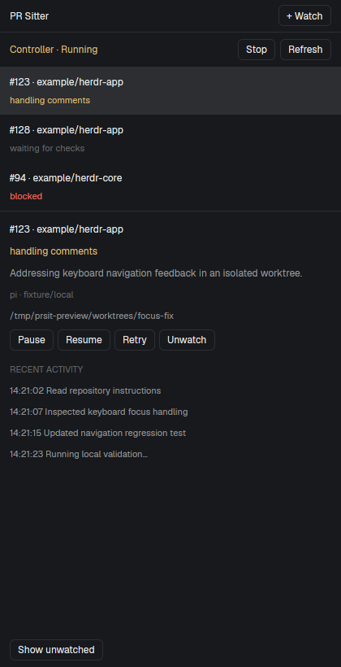

# PR Sitter

A native herdr-app companion for autonomous PR monitoring and repair. A compact
control sits beside Ship-it's strip; a panel in the same side-panel stack shows
watched PRs, their exact stages, controller health and recent activity. The
controller runs independently in herdr-core. Ship-it is optional.

## What you see

- A 40px toolbar row. Alongside Ship-it, its existing strip gets the flexible
  width and PR Sitter gets 210px. The PR Sitter button shows the number of active
  watches; a small label says Connecting, Running, Stopped or Unavailable.
- A native panel with a 40px heading and **+ Watch** button, then controller
  health, **Start/Stop** and **Refresh** controls. Controls are 26px high, with
  6px rounded corners and theme border/background/hover colors. General text is
  12px; supporting text and activity are 11px. No hard-coded light/dark palette.
- A scrollable watch list. Rows show PR number, owner/repository and the backend's
  stage label. Selection uses the theme's selected surface. Stages use semantic
  working/blocked/idle/unknown colors and always remain readable as text.
- Selected details: repository/PR, exact stage, status message, agent/model,
  optional repair worktree path, Pause/Resume/Retry/Unwatch buttons, and recent
  activity. Show unwatched/Hide unwatched sits at the bottom.
- The watch form has five fields: PR number/URL, local checkout, optional model,
  validation command, and polling interval. An explicit notice explains that
  registration authorizes commits, pushes, replies, thread resolution and
  eligible merging. Errors appear above the form/list.

## How it behaves

- Clicking the strip selects `prsit-panel` in `panel-body` and reveals `panel`.
  Without that stack it opens a PR Sitter tab. It does not reuse arbitrary panes
  whose backend/state-directory identity the host API cannot expose. It never opens a terminal for each watch.
- Clicking a watch pins selection and loads its bounded activity. Each action
  captures that row's watch ID; a later selection cannot redirect it.
- Working shows actual repair/publication stages. Blocked shows the backend's
  reason. Waiting is idle, not finished. Merged/closed remain terminal labels;
  seeing them never changes the label to generic idle. A stopped controller
  replaces unfinished stages with controller stopped, not stale working state.
- The backend is sampled every five seconds; identical snapshots do not redraw.
  Failed controls remain visible even if later health polls succeed. Commands
  cannot overlap within a mod copy. Timers never animate.
- Unwatch retains history and worktrees. Resume reactivates a retained watch.
  Retry uses the backend's existing blocked-work protocol, not a second engine.
- Start asks `prsit start` to create/reconnect to an independent hc controller.
  Stop requests checkpointed shutdown. Hiding, closing, reloading or changing
  layouts never stops the controller. Reboot recovery requires starting it again.
- Bindable mod commands are `prsit.watch`, `prsit.refresh`, and focus navigation.
  Do not replace existing user keybindings during installation.

## Built from

- `mods/prsit/main.js` default-exports a gpui-kit View, with gpui-base flex,
  InputState and Input builders. Props `role: "strip"` selects the compact
  control; `role: "panel"` or no role selects the panel. Optional `watch`
  selects a watch ID. `config.js` provides machine-local backend configuration;
  props can override it with `command`, `args`, and `stateHome`.
- `client.js` builds argv and validates the versioned snapshot. All operations
  use herdr's `exec`, never a shell string. Theme/focus/layout/pane data come
  from `herdr`; layout navigation uses `run`. `nextCommand` handles bindings.
- Backend reads: `prsit snapshot [watch]`. Backend writes: existing `watch`,
  `pause`, `resume`, `retry`, `unwatch`, `start`, and `stop` commands. The mod
  does not read SQLite, parse terminal screens, or directly call GitHub/models.
- `scripts/install.mjs` copies only owned mod assets and records machine-local
  configuration. `scripts/layout.mjs` purely transforms a personal layout:
  wrap Ship-it's strip in `prsit-toolbar` beside `prsit-strip`, or add the strip
  after tabs; add `prsit-panel` to `panel-body` if available. Repeated installs
  are idempotent, existing blocks/selection are retained, collisions fail, and
  the original personal layout is backed up. No automatic layout switch.
- Preview data comes from `scripts/preview-fixture.mjs`, which rejects all writes.
  `preview.png` is the actual native renderer with that fictional data.

## Watch out

- Requires Node 22.19+, built backend dependencies, git, authenticated gh, Pi
  credentials, current herdr-app and hc. The mod is not a standalone agent.
  Keep the installed backend path in place, and update mod/backend together.
- Local machine only. Never apply a remote space's path to the local controller.
  A custom PRSIT_HOME must match between mod and CLI. Each machine has independent
  state; duplicate registration in separate state directories is not coordinated.
- Ship-it integration is visual/layout composition. Do not patch its source,
  rely on its private `ship-it.pr` cache, or use its readiness indicators as
  merge authorization. PR Sitter's controller remains the sole policy authority.
- Native activity is limited to the backend's latest 32 KiB / 1,000 lines.
  Complete history is available with `prsit logs`. Registration's advanced
  options, including OpenCode and Codex review gating, remain available via CLI.
- The installer must not change shipped layouts or overwrite unmanaged mod
  directories. Removing the UI does not stop an authorized controller. Old TUI
  receipts are ignored, not deleted. The standalone Ink dashboard stays usable.
- Generated `gpui-kit.d.ts` and `jsconfig.json` from mod checking are not assets.
  Do not ship or lint them. Never retain cx across callbacks.
- macOS compatibility is unverified until tested on a Mac.

## Done when

- The package builds and its fixture-based tests, lint and format checks pass.
- A clean isolated-home install passes `herdr-app check`; repeating layout
  installation leaves the same tree and preserves Ship-it's active panel.
- In the actual native renderer, inspect list/detail, watch form, error, stopped,
  and history behavior at panel widths; test its deferred states, not only the
  initial check. Native controls target the selected watch and show failures.
- A controller started once reconnects on a second Start, survives mod reload
  and app-window close, and stops through the normal checkpoint protocol.
- No provider calls, live PR writes, credentials, or real watch state appear in
  default tests or the preview. The README documents installation and removal.
