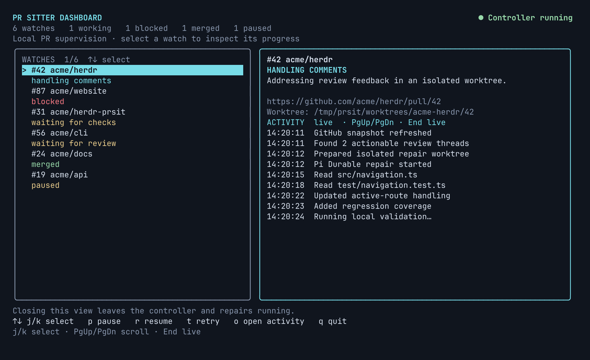
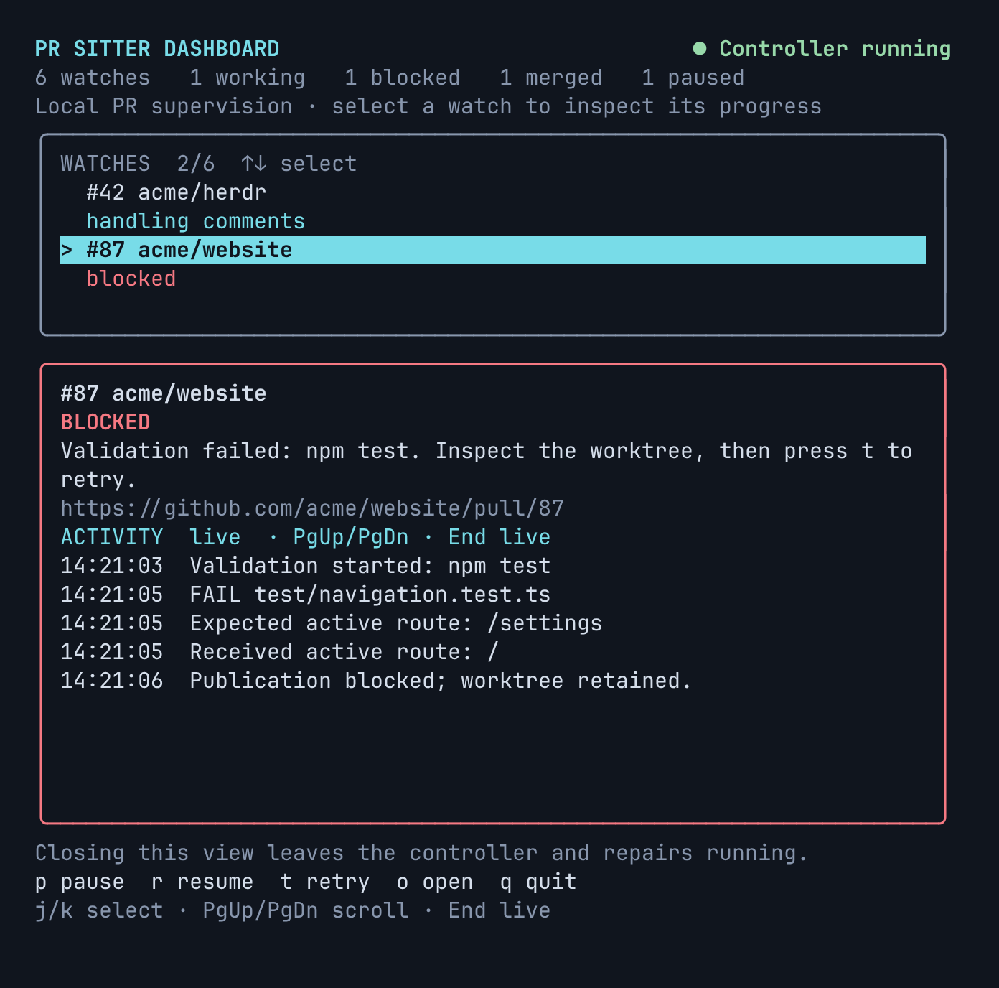
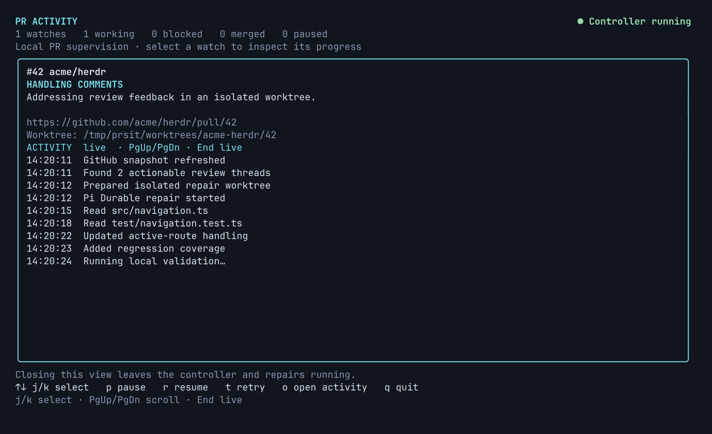
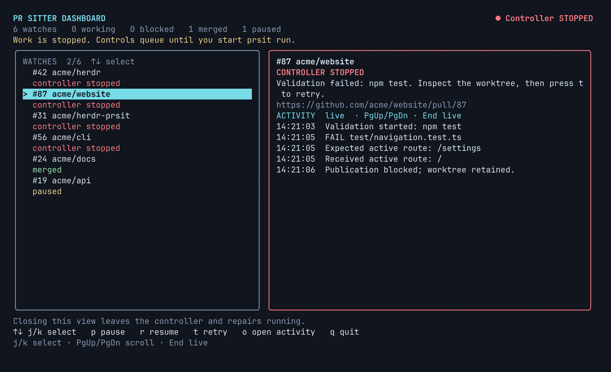
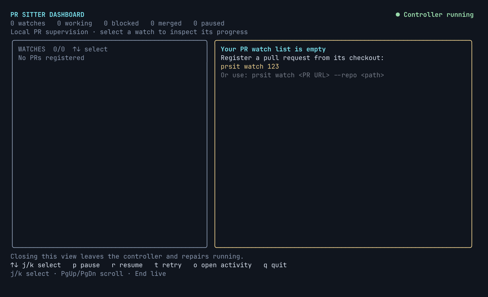

# Dashboard previews

These screenshots capture the actual Ink renderer's ANSI output in xterm.js using
local, fictional watch fixtures. They are not live GitHub activity or Herdr sidebar
captures. The palette belongs to the capture terminal; your terminal theme controls
the actual colours. macOS compatibility has not yet been tested on a Mac.

| Wide dashboard                        | Narrow dashboard / blocked PR             |
| ------------------------------------- | ----------------------------------------- |
|  |  |





Preview without reading or modifying your watch state:

```sh
npm run build
node scripts/dashboard-preview.mjs wide
node scripts/dashboard-preview.mjs narrow
node scripts/dashboard-preview.mjs activity
node scripts/dashboard-preview.mjs stopped
node scripts/dashboard-preview.mjs empty
```

Optional screenshot regeneration (Playwright and xterm.js are not runtime or test
suite dependencies):

```sh
npm install --prefix /tmp/prsit-capture-tools --ignore-scripts playwright @xterm/xterm
# Use an existing Chromium installation:
PRSIT_CHROMIUM_PATH=/usr/bin/chromium node scripts/dashboard-screenshots.mjs
# Or install Playwright's Chromium and omit PRSIT_CHROMIUM_PATH:
/tmp/prsit-capture-tools/node_modules/.bin/playwright install chromium
node scripts/dashboard-screenshots.mjs
```

`PRSIT_SCREENSHOT_TOOLS` overrides the temporary tools directory. Optional real
pseudo-terminal checks (Python 3, Linux/macOS; local fixtures only):

```sh
python3 scripts/dashboard-pty-smoke.py
python3 scripts/dashboard-pty-smoke.py ctrl-c
python3 scripts/dashboard-pty-smoke.py signal
```
